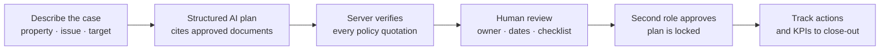

# Hi, I'm Nicolas 👋

**Software engineering · AI applications · hospitality technology**
📍 Singapore · 🎓 [42 Singapore](https://42.fr/en/) · 🌍 English & French (native), Spanish (business)

I came into software from hotel revenue management: Cluster Revenue Analyst at **Marriott International** (Hong Kong), then Director of Revenue Management & Sales at **Explorar Hotels & Resorts** (Thailand), with an MSc in International Hospitality Business from Glion. I know the operational problems first-hand.
Now I engineer the solutions: from low-level C (memory, processes, file descriptors) up to full-stack TypeScript and AI systems that people can actually trust.

🔨 **Currently:** [42 Singapore](https://42.fr/en/) final team project **Transcendence**, a five-person platform for comparing how inference-scheduling policies affect latency and system performance (Python/FastAPI, C++ simulation engine, JSON Schema contracts, WebSocket). I coordinate scope as PM and own the researcher-facing Console. It is in development.

---

## ⭐ Featured

<table>
<tr>
<td width="220" align="center" valign="top">
  
</td>
<td valign="top">

### [SustainOps](https://github.com/Equinox201/SustainOps): AI-assisted sustainability operations for hotels

Turns an operational issue (say, rising laundry volume) into an action plan that **cites approved company documents**, with **every policy quotation verified server-side** and a **person reviewing and approving** before anything is locked and tracked against KPIs.

[**Live demo**](https://sustainops.vercel.app) · [**Evaluation results**](https://sustainops.vercel.app/evals) · [Source](https://github.com/Equinox201/SustainOps)

</td>
</tr>
<tr>
<td width="220" align="center" valign="top">
  
</td>
<td valign="top">

### [TimeTracker42](https://github.com/Equinox201/TimeTracker42): attendance pace tracker for 42 students

See whether you are ahead or behind your monthly goal and plan the rest of the month. OAuth sign-in, per-user data isolation with Postgres row-level security, end-to-end tested, installable as a PWA.

[**Live demo**](https://timetracker42.pages.dev/demo) · [Source](https://github.com/Equinox201/TimeTracker42)

</td>
</tr>
</table>

### How SustainOps keeps AI accountable

---

## 🛠️ Systems programming (42 curriculum, C / C++)

Built from scratch under strict constraints: no external libraries, manual memory management, Norm-compliant code.

<table>
<tr>
<td align="center" valign="top" width="33%">
   
  <b><a href="https://github.com/Equinox201/HTTP_Server-Webserv">Webserv</a></b> 
  HTTP/1.1 server in C++: non-blocking I/O event loop, CGI, request parsing. Passed with bonus.
</td>
<td align="center" valign="top" width="33%">
   
  <b><a href="https://github.com/Equinox201/Unix_Command_Shell">Minishell</a></b> 
  Unix shell in C: parsing, pipes, redirections, environment, process control
</td>
<td align="center" valign="top" width="33%">
   
  <b><a href="https://github.com/Equinox201/Raycasting_Engine_Cub3D">Cub3D</a></b> 
  3D raycasting engine in C: textured rendering, real-time camera (MiniLibX)
</td>
</tr>
<tr>
<td align="center" valign="top">
   
  <b><a href="https://github.com/Equinox201/Multi-threading_Dining_Philosophers">Philosophers</a></b> 
  Concurrency in C: threads, mutexes, deadlock prevention, timing constraints
</td>
<td align="center" valign="top">
   
  <b><a href="https://github.com/Equinox201/Containerized_Infrastructure-Inception">Inception</a></b> 
  Docker orchestration and system administration
</td>
<td align="center" valign="top">
   
  <b><a href="https://github.com/Equinox201/Tower_of_Hanoi_Sorting_Algorithm">Push_swap</a></b> 
  Sorting under strict operation limits: recursive logic and optimisation
</td>
</tr>
</table>

Also: [Escape the Dragon Dungeon](https://github.com/Equinox201/Escape_the_Dragon_Dungeon), a Pac-Man-inspired maze game in C · Full write-ups in [42_Projects](https://github.com/Equinox201/42_Projects).

---

## 🧰 Toolbox

## 🧭 How I work

Predictable systems over clever hacks. Clear responsibility boundaries, defensive programming, explicit error handling, and evidence (tests, evaluations) over claims.

## 🍜 Beyond code

I cook, travel and write about it at **[NomadBowl](https://nomadbowls.cc)**, a site of recipes and stories from around the world. Outside the kitchen: triathlon training, piano, hiking and camping.
